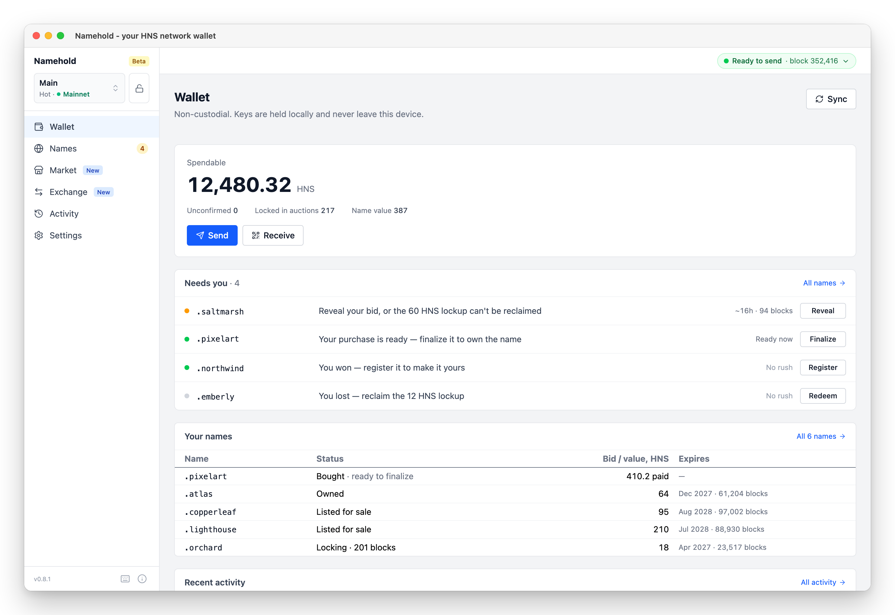
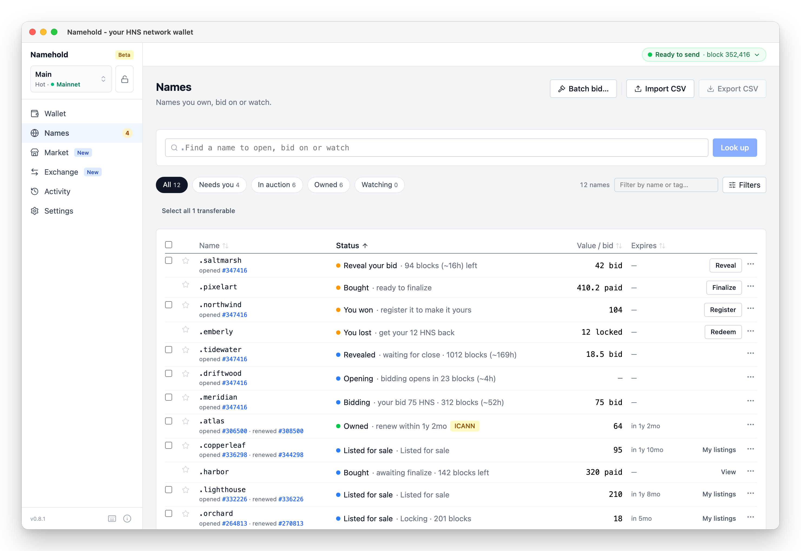
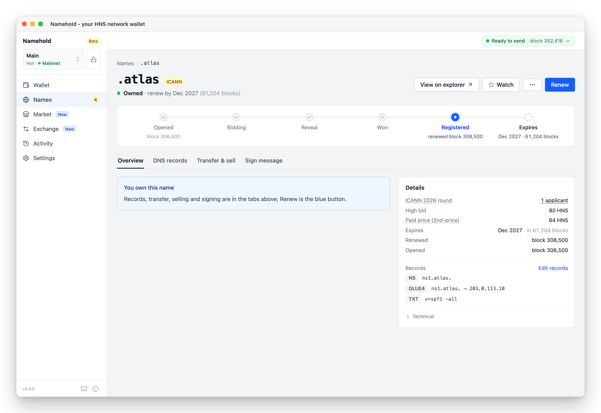
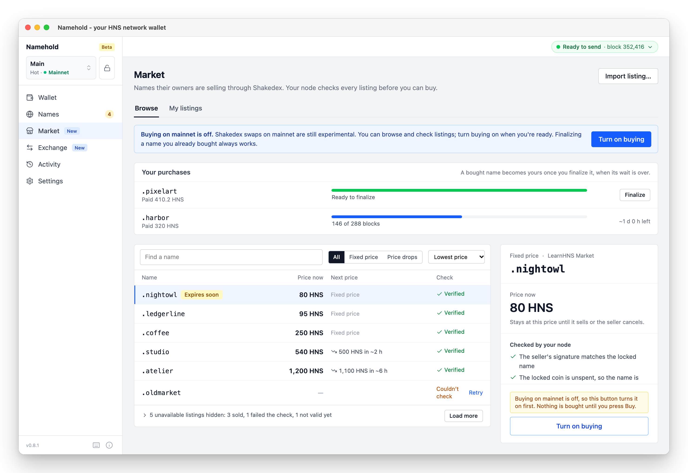
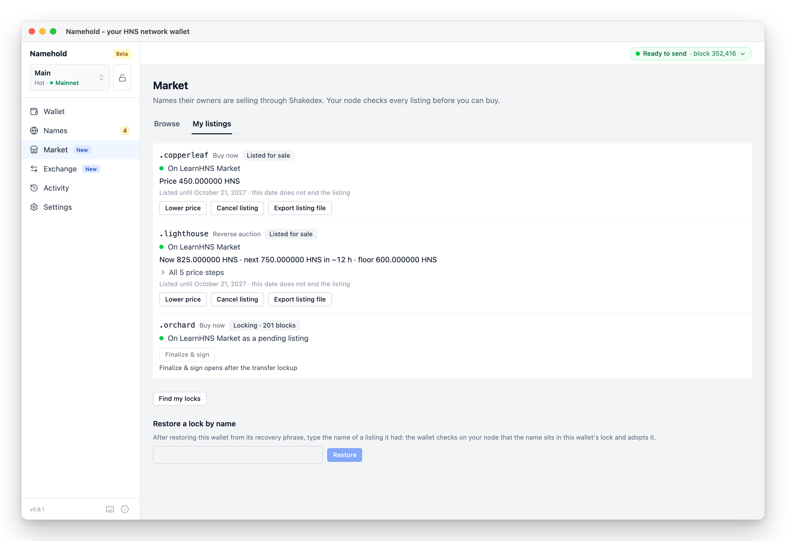
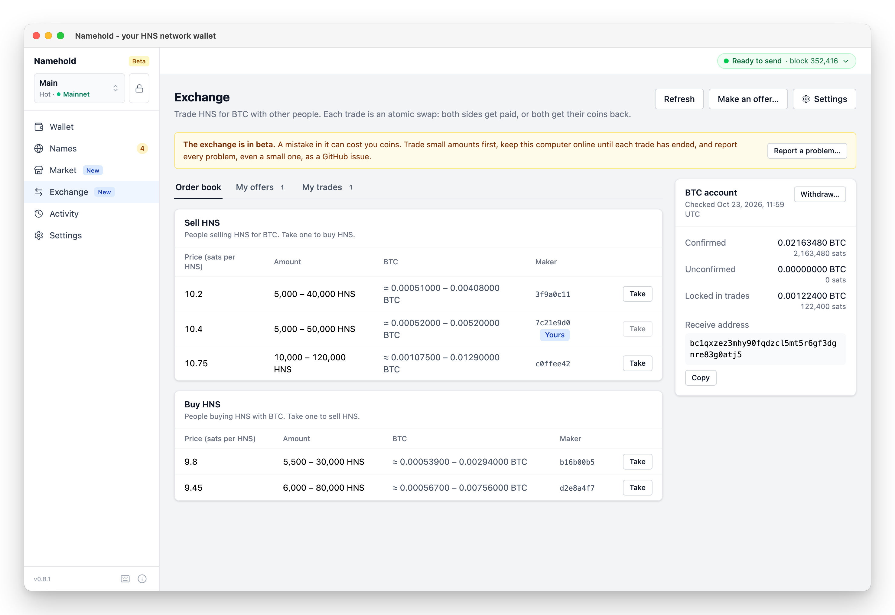
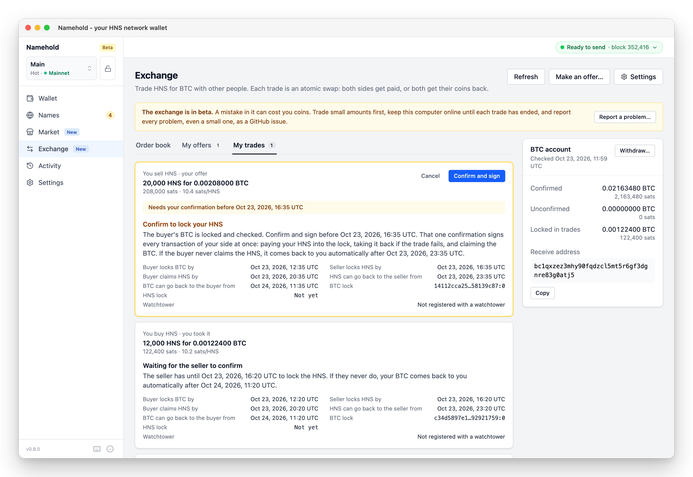
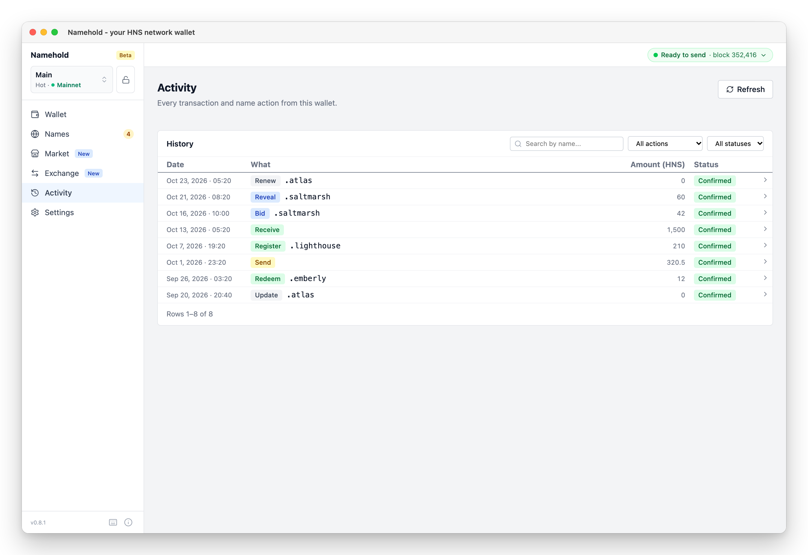
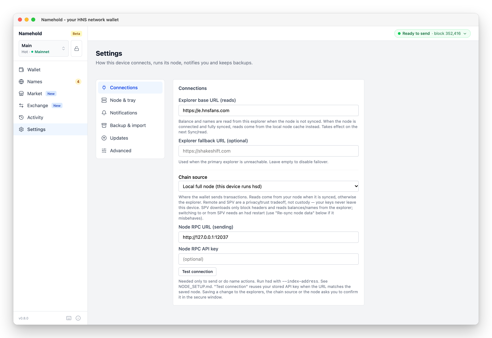

# Namehold — a non-custodial Handshake (HNS) wallet

[](https://github.com/DimazzzZ/namehold-wallet/pull/50)

Namehold is a local desktop wallet for **Handshake (HNS)**: hold HNS, manage the
names you own, run the full name-auction lifecycle, edit on-chain DNS, buy and sell names through Shakedex, and trade HNS for BTC with other people by atomic swap — all
non-custodially, with your keys encrypted on your own machine. It used to include a **Move from Namebase** helper; the legacy custodial Namebase closed on 1 October 2026, so that part of the app, now Import from Namebase under Settings › Backup & import, explains the shutdown and keeps only the import of history you exported earlier.

Built with Tauri v2, React + TypeScript, Rust, and SQLite.

<p align="center">
  
</p>

> ⚠️ **Beta software.** Namehold is under active development and can make mistakes.
> Transactions, transfers and name sales are **irreversible** — always test with a
> single name or a small amount and confirm it arrives **before** sending or
> transferring everything.

## Screenshots

<table>
  <tr>
    <td width="50%"><a href="docs/assets/names.png"></a></td>
    <td width="50%"><a href="docs/assets/name.png"></a></td>
  </tr>
  <tr>
    <td align="center">Names</td>
    <td align="center">A name, with the ICANN 2026 round flag</td>
  </tr>
  <tr>
    <td width="50%"><a href="docs/assets/market.png"></a></td>
    <td width="50%"><a href="docs/assets/market-listings.png"></a></td>
  </tr>
  <tr>
    <td align="center">Market (Shakedex)</td>
    <td align="center">Selling your names</td>
  </tr>
  <tr>
    <td width="50%"><a href="docs/assets/exchange.png"></a></td>
    <td width="50%"><a href="docs/assets/exchange-trades.png"></a></td>
  </tr>
  <tr>
    <td align="center">Exchange HNS ⇄ BTC (beta)</td>
    <td align="center">Your trades</td>
  </tr>
  <tr>
    <td width="50%"><a href="docs/assets/activity.png"></a></td>
    <td width="50%"><a href="docs/assets/settings.png"></a></td>
  </tr>
  <tr>
    <td align="center">Activity</td>
    <td align="center">Settings</td>
  </tr>
</table>

The screenshots are generated from the app with showcase data: see [screenshots/README.md](screenshots/README.md).

## Install

Download the latest build from [Releases](https://github.com/DimazzzZ/namehold-wallet/releases/latest):

| Platform | File |
|----------|------|
| macOS (Apple Silicon and Intel) | `Namehold_<version>_universal.dmg` — not code-signed yet, see [macOS](#macos) |
| Windows | `Namehold_<version>_x64-setup.exe` |
| Linux | `Namehold_<version>_amd64.AppImage`, `.deb` or `.rpm` |

On macOS you can also install it with [Homebrew](https://brew.sh) from [DimazzzZ/homebrew-tap](https://github.com/DimazzzZ/homebrew-tap):

```bash
brew install --cask dimazzzz/tap/namehold
```

The cask installs the same `.dmg` from the latest release and checks it against that release's sha256. The app is still not code-signed, so the first launch needs the step in [macOS](#macos).

Once installed, the app updates itself (see [Auto-update](#auto-update-since-v020)). On first launch it asks how to connect: a local full node, a remote node or SPV. On Windows, a local node needs a Node RPC API key set in Settings › Connections first.

## Features

### Wallet (the core)
- **Create or import** a wallet from a BIP39 mnemonic, or add a **watch-only**
  wallet from an account xpub.
- **Hardware wallet support** — connect a **Ledger Nano S / S Plus / X** and let
  the device sign every transaction. Private keys never leave the device; you
  confirm each send, bid, or covenant action on-screen. Requires the official
  [`ledger-app-hns`](https://github.com/handshake-org/ledger-app-hns) firmware.
- **Multiple wallets** — switch between them and delete ones you no longer need.
- **Receive** — a dialog with your address, a QR code and one-click copy. "All addresses" lists every derived receive address with its derivation index, used/fresh badge and copy/QR/explorer buttons, and "New address" allocates the next unused index.
- **Per-wallet balances** — each wallet shows its own balance; values persist and
  refresh on demand (no bleed between wallets).

### Send HNS
- A **build → sign → broadcast** draft flow: preview fee/change before any key is
  touched, sign in the secure window, then broadcast.
- **Fee-rate control** — set a global default fee rate in Settings > Advanced, or
  override per-transaction with a collapsible "Advanced" widget in every send/bid/
  batch flow. Minimum 1000 doos/kvB (1 sat/byte).
- **Send Max** to sweep a wallet.
- **Status tracking** — sent transactions move Pending → Confirmed (with block
  height); a transaction the node did not accept reads "Not sent", and one that
  never makes it on-chain is flagged with the reason.
- **Speed up** — a sent, unconfirmed transaction or purchase that pays too little
  for full blocks gets a child transaction that pays for both (hsd has no
  replace-by-fee), from Activity or Your purchases.

### Names & auctions
- The complete Vickrey-auction lifecycle: **open, bid, reveal, redeem, register,
  update, transfer, finalize, cancel, renew, revoke**.
- **Phase badges + countdowns** for each owned name, a **reveal-required alert**,
  and a **"Locked in auctions"** balance for in-flight bids.
- A typed **DNS-record editor** (TXT, NS, DS, GLUE4/6, SYNTH4/6) for register/update, with a
  raw-JSON fallback.
- **Several bids on one name**, each with its own value and lockup; Reveal and
  Redeem take all of them in one transaction.
- **Batch operations** — bid, renew, reveal, redeem, finalize or transfer multiple names, in one transaction per 100 names. Multi-select checkboxes on the Names page with a
  batch action bar and a confirmation modal showing estimated fee + name list.
- **Watching names** — track names you don't own on the Names page's Watching chip, with a star on every row, tags, and CSV import/export.
- **ICANN collision flag** — a name that someone has also applied for as a new gTLD in ICANN's 2026 round carries an ICANN badge on the Names page and on its own page, Details names the applicants with links to their applications, and a Names filter shows every such name. The list ships with the app (`just icann-strings` refreshes it); the app never contacts ICANN.
- **Buy names on the Market** — browse LearnHNS Market listings, verified against your own node, or import a listing file, pasted JSON or a market.learnhns.com link, and buy at the current step. One list with search, filters and sorting sits beside a panel that shows the selected listing's price, what your node checked, and the price, market fee and network fee before you buy; the purchase then shows in Your purchases and on the Names page until you finalize it. Needs a node and a recovery-phrase wallet; on mainnet, buying is behind "Allow buying and selling names on mainnet through Shakedex (experimental)" in Settings, which the Market offers to turn on.
- **Sell names through Shakedex** — Sell…, on a name's Transfer & sell tab, locks the name for sale as a Buy Now or a reverse auction; once the transfer lockup is over, Finalize & sign sets the price or the schedule and signs every price at once. Market › My listings follows each listing to Sold or back home, with Lower price, Cancel listing and Finalize home, and Export listing file, and warns before buyers stop seeing a listing whose name nears expiry. A wallet restored from its recovery phrase finds its locked names on its first sync (Find my locks, or Restore a lock by name, for the rest), and a listing managed from another device of the same phrase is recognised and can be taken over. The listing file is a Shakedex v2 listing that the shakedex CLI can buy; on mainnet it can also be published on LearnHNS Market, where the app and the background daemon keep it at its current price. Needs a node that can send and a recovery-phrase wallet; mainnet selling is behind the same experimental setting as buying.
- **Recover lost bids** — if you lose your local bid data (reinstall, seed-
  restore, import from another wallet), Namehold can brute-force the bid value
  from your account xpub and reveal it before the window closes. See
  [`docs/RECOVER_LOST_BIDS.md`](docs/RECOVER_LOST_BIDS.md).

### Exchange HNS ⇄ BTC (beta)
- **Trade HNS for BTC with other people** on the Exchange page: an order book of offers to sell and to buy HNS, your own offers and trades, and a **Bitcoin account** made from your recovery phrase (BIP 84, so any Bitcoin wallet restores it). On mainnet a trade is 0.0005 to 0.1 BTC; making an offer, the form shows what a trade locks and brings and which amount or price fits those limits.
- **An atomic swap**: both sides get paid, or both get their own coins back, and nobody holds your coins in between. One confirmation in the secure window signs every transaction of your side; the background sync then reveals, claims and refunds on its own, sending only what you signed.
- **No server to trust or run**: offers and trade messages go through public **Nostr relays** (six by default, editable in Exchange settings), trade messages encrypted to the other side. A `namehold-relay` someone you trust runs can be used instead, and can also be your watchtower ([docs/RELAY.md](docs/RELAY.md)).
- **Checked, not trusted**: Bitcoin locks are proven by proof of work and every Bitcoin source must agree; the HNS side needs a node on this computer. Relays and sources can delay a trade, never redirect coins.
- It is a beta: trade small amounts first, keep the computer online until a trade ends, and report every problem as a GitHub issue. See the [User Manual](docs/USER_MANUAL.md) and [SECURITY.md](SECURITY.md#the-exchange-hns--btc).

### Node-free reads
- Reads are **node-free by default** via the HNSFans explorer — no node required
  just to view your wallet. Only mainnet has a built-in explorer; testnet and
  regtest read node-free only with an explorer URL you configure. When your local hsd is synced, the app automatically
  switches to **node-authoritative** reads (owned names, balances, bid history)
  for faster, more reliable data. A local node is needed **only to send, perform name actions
  or use the Exchange**.
- When you click a transaction, name, or address link, it opens on **Shakeshift**
  (https://shakeshift.com) for viewing on-chain details.

### Move from Namebase (retired)
- The legacy custodial Namebase (sunset.namebase.io) shut down on 1 October 2026 and no longer answers, so the wallet can no longer connect to it, list, transfer or withdraw. The notice in Settings › Backup & import says so, points to Namebase's sunset guide for the manual recovery of anything left there, and still imports an account-history CSV you exported earlier.

### Auto-update (since v0.2.0)
- Namehold checks for updates automatically ~30 seconds after launch. When a
  new version is available, a banner appears at the top of the window offering
  a one-click install; you can also check manually in **Settings > Updates**.
  Update bundles are **Ed25519-signed** at release and verified against the
  embedded public key before install; unsigned or tampered bundles are rejected.

### Background sync

- Namehold can keep your wallet data fresh even when the app is closed. A
  lightweight background daemon (`namehold-syncd`) wakes every 60 seconds and
  syncs all wallet profiles (UTXOs, name states, transactions) from each
  profile's node into the shared SQLite database.
- Controlled by a Settings checkbox **"Sync in background"** (default ON).
- When enabled, hsd stays running after you close the app so the daemon can
  query it; the next app launch adopts the running node (no duplicate spawned).
- Crash recovery: if the daemon dies, the app respawns it on startup.
- The background daemon never signs; it publishes listings already signed to LearnHNS Market (on mainnet, for listings you chose to publish), keeps your Exchange offers listed and answers takes, sends only the exchange transactions you signed at a trade's Commit, and sends the Shakedex "Ready to finalize" reminders and the Exchange's notifications, so they arrive with the app closed.

### Connections: local node, remote node, SPV

- **Chain source** in Settings → Connections (and the first-run screen) picks how
  the wallet reaches the network: **Local full node** (the app runs hsd on this
  device; the default), **Remote node** (an hsd you run elsewhere), **SPV** or
  **Read-only**.
- **Remote node** — point at an existing hsd's RPC; **Test connection** checks that
  it is reachable, synced and on the wallet's network before you save. Sending
  through it is off until you tick **"Allow sending via remote node"**. Your keys
  never leave the device either way.
- **SPV** — a **lightweight alternative** to the full node: it downloads only
  block headers (~tens of MB vs ~15GB), enabling fast first launch and minimal disk
  usage. **Balance and name data come from the explorer** — sending is blocked in SPV
  mode (read-only). hsd then runs with `--spv` instead of `--index-address
  --index-tx`.
- **Explorer failover** — all explorer HTTP requests support automatic failover to a
  configurable fallback URL.
- **SPV indicator** in the readiness pill's panel — reads "Reads from the explorer (SPV)" when in SPV mode.

### Keyboard-first navigation

- **Command palette** (⌘K / Ctrl+K) — fuzzy-searchable list of navigation targets
  and view actions on the current page. Type to filter, ↑/↓ to move, Enter to run.
- **Cheatsheet** (Shift+?) — overlay documenting all bindings for the current page.
- **Sections** — `1` Wallet, `2` Names, `3` Market, `4` Exchange, `5` Activity, `6` Settings.
- **Per-page shortcuts** — common flows without the mouse:
  - **Wallet** (`/`): `s` send, `r` sync, `u` lock or unlock, `q` open Receive
  - **Names** (`/names`): `/` find a name, `b` batch bid, `j`/`k` + Enter to walk the list and open a name
  - **Market** (`/market`): `/` search, `i` import a listing, `j`/`k` + Enter to
    walk the list and press the listing panel's button
  - **Activity** (`/activity`): `/` search

## How it works

- **Reads are node-free** on mainnet. Balances and names come from the explorer
  and are cached locally per wallet; other networks need an explorer URL of yours. Links to transactions, names, and addresses open on Shakeshift.
- **Sending needs a node.** Broadcasting and coin/owner discovery use an **hsd**
  node over RPC: a local one the app can start/stop for you, or a remote one with
  sending allowed (Settings → Connections). The Exchange accepts only a node on this computer.
- **Secrets stay in a secure window.** Your mnemonic/passphrase is only ever typed
  into — and your backup phrase only ever shown in — a small **Rust-owned window**;
  it never passes through the web UI. At rest it's an **encrypted vault**
  (Argon2id + AES-256-GCM) inside the local database.
- **Write-capability gating.** Spend/name actions are enabled only when the signer
  is unlocked **and** the node is reachable, synced, and address-indexed — with a
  precise reason shown when any condition isn't met.
- **Background sync daemon.** When "Sync in background" is enabled (Settings › Node & tray, default ON), a separate Rust binary syncs all profiles every 60s and runs the Exchange's step for each. A cross-process DB lock table (`sync_locks`) coordinates the app's manual Sync and the daemon via heartbeats (10s) and stale-lock takeover (30s); the app's Sync takes the lock from a daemon run. A run whose lock is taken over stops at its next check, within one heartbeat, and the LearnHNS Market jobs read the lock row before each listing, so they stop at once. The daemon writes its PID to `~/.namehold/syncd.pid` for lifecycle tracking.

## Security

For a detailed threat model, attack surfaces, and mitigations, see [SECURITY.md](./SECURITY.md).

- **Non-custodial** — your keys live on your device, encrypted; nothing is custodied.
- **Secrets never reach the web layer** — entry/display happen in the secure window,
  and signing happens in Rust.
- **Local-first** — keys and secrets stay on your device (encrypted at rest). By
  default, balance and name lookups query the public HNSFans explorer, which sees
  your wallet addresses and tracked names. Run your own hsd node (Settings) to keep
  all lookups fully local. The Exchange talks to public Nostr relays and Bitcoin sources, which see your IP address and, for the relays, who trades with whom and when. No cloud, no telemetry.
- **Auto-lock** — the unlocked signer locks after a configurable idle period (1 to 60 minutes) and at the latest an hour after it was unlocked; the decrypted master key is dropped, its bytes overwritten, within a second of the session expiring.
- **Namebase migration (retired)** — the legacy Namebase it talked to shut down on 1 October 2026. A session cookie stored before then stays encrypted at rest and is never exposed to the web layer; disconnecting clears it. See [SECURITY.md](./SECURITY.md) for the threat model.

## Prerequisites

- [Node.js](https://nodejs.org/) 22+
- [pnpm](https://pnpm.io/) 11+ (CI pins `11.17.0` via the `packageManager`
  field; run `corepack enable` to match it locally)
- [Rust](https://www.rust-lang.org/tools/install) (stable, edition 2021)
- [hsd](https://github.com/handshake-org/hsd) — **only needed for sending, name
  actions and the Exchange** (reads work without it). Run it with `--index-address`.

## Quick start

```bash
git clone https://github.com/DimazzzZ/namehold-wallet.git
cd namehold-wallet
pnpm install
pnpm tauri dev
```

`pnpm install` also sets `core.hooksPath` to `.githooks/` in your clone: git hooks (`scripts/check-secrets.mjs`) refuse a recovery phrase or private key before it leaves your machine. It does nothing in CI and refuses, with a message, if your clone already uses other git hooks.

## Running a node (only to send)

Reads need no node. To send HNS or perform name actions, run an **address-indexed**
hsd node:

```bash
hsd --index-address --index-tx --api-key=<your-key>
# mainnet node RPC: http://127.0.0.1:12037
```

- `--index-address` is **required** (the wallet finds your coins by address);
  `--index-tx` backs transaction history + confirmation tracking.
- The app can manage hsd for you (on Windows, set a Node RPC API key in Settings › Connections first) — set the **data directory** and (if needed) the **hsd binary path** in **Settings › Node & tray**, then click **Start mainnet node** there or in the readiness pill (it names the active wallet's network).
- **hsd can't add an index to an already-synced chain.** If your existing chain
  was synced without these indexes, the app detects it and offers a **one-click
  re-sync** (it moves the old chain to a backup and re-syncs with the right indexes).

| Network | Node RPC port |
|---------|---------------|
| Mainnet | 12037         |
| Testnet | 13037         |
| Regtest | 14037         |

See [`docs/NODE_SETUP.md`](docs/NODE_SETUP.md) and
[`docs/REGTEST_TESTING.md`](docs/REGTEST_TESTING.md) for details.

## Move from Namebase

The legacy custodial Namebase (sunset.namebase.io) closed on 1 October 2026 and answers every request with "Namebase has shut down", so this helper can no longer connect, list your custodial domains, transfer names out or withdraw HNS. Namebase's own guide says anything still held there now goes through a manual recovery process with extra verification and fees; the notice in **Settings › Backup & import › Import from Namebase** links to it. What still works is importing an account-history CSV you exported from Namebase before the shutdown.

## Build for production

```bash
pnpm tauri build
```

Output in `src-tauri/target/release/bundle/` — macOS `.app`/`.dmg`, Windows `.msi`
and `-setup.exe` (releases ship the `-setup.exe`), Linux `.AppImage`/`.deb`/`.rpm`. CI (PR tests), an advisory dependency audit (`cargo audit` +
`pnpm audit`), and the cross-platform release pipeline live in
[`.github/workflows`](.github/workflows).

## macOS

The macOS and Windows builds are not code-signed, so your system cannot tell you who made them. Check the download yourself before you open it (releases after 0.6.1):

```bash
# Is this the file the release lists? Download SHA256SUMS and SHA256SUMS.sig from the same page.
shasum -a 256 -c SHA256SUMS --ignore-missing

# Is the list signed by Namehold's key? minisign is at https://jedisct1.github.io/minisign/
curl -s https://raw.githubusercontent.com/DimazzzZ/namehold-wallet/main/src-tauri/tauri.conf.json \
  | jq -r .plugins.updater.pubkey | base64 -d > namehold.pub
base64 -d < SHA256SUMS.sig > SHA256SUMS.minisig
minisign -V -m SHA256SUMS -x SHA256SUMS.minisig -p namehold.pub

# Was the file built by this repository's release workflow?
gh attestation verify Namehold_*.dmg --repo DimazzzZ/namehold-wallet
```

Every file on the release except `latest.json`, whose entries carry the signatures, has its own `.sig`, checked the same way. These show that a file matches what the release workflow built and signed. They are made with the key that also signs updates, online in that workflow, so they do not protect against someone who has stolen that key.

On first launch macOS may show:

> "Namehold" can't be opened because Apple cannot check it for malicious software.

Open **System Settings → Privacy & Security** and choose **Open Anyway**. If macOS says the app is damaged and offers no such button, and only if the checks above passed, remove the download flag from this one app:

```bash
xattr -r -d com.apple.quarantine /Applications/Namehold.app
```

Do not do this for a file you could not check: that flag is what makes macOS ask.

## Data location

All app data lives in one SQLite file in your home folder (pairs with hsd's `~/.hsd`),
on every platform:

- `~/.namehold/portfolio.db`
- `~/.namehold/syncd.pid` — background sync daemon's process ID (present only
  while the daemon is running)

It holds your wallet profiles, the encrypted vault, the local chain cache, (if
used) the local transaction history, and your Exchange offers and trades, including a buyer's swap secret until the trade reveals it.

## Tech stack

- **Tauri v2** — desktop shell
- **React 19 + TypeScript** — frontend
- **Vite** — build tool
- **TanStack Query** — async state (TanStack Table + Virtual for data tables and
  virtualized lists)
- **Zustand** — client state
- **Zod** — validation
- **SQLite (rusqlite)** — local database
- **reqwest** — HTTP client (explorer, hsd RPC, Bitcoin sources, LearnHNS Market)
- **rust-bitcoin** — the Exchange's Bitcoin transactions and scripts
- **tokio-tungstenite · hkdf · chacha20** — the Exchange's Nostr client and NIP-44 encryption
- **axum** (optional, `relay-server` feature) — the `namehold-relay` server
- **secp256k1 · bip39 · argon2 · aes-gcm · zeroize** — keys, mnemonics, vault crypto
- **hidapi** — Ledger hardware wallet HID transport
- **notify-rust** — cross-platform OS notifications (deadlines, watchlist alerts, Exchange)
- **Tailwind CSS** — styling

## Coverage

Unit test coverage is measured with `cargo-llvm-cov` on nightly:

```bash
just coverage
# or manually:
cargo +nightly llvm-cov --lib --ignore-filename-regex '(src/lib\.rs|src/daemon/mod\.rs)'
```

**Why nightly?** The codebase uses `#[cfg_attr(coverage_nightly, coverage(off))]`
attributes to exclude genuinely-untestable IO shells (device spawning, OS window
construction, USB-HID communication, HTTP requests) from coverage metrics, so that
coverage numbers reflect testable logic only. These attributes require the
`coverage_attribute` feature, which is nightly-only. The stable build is unaffected
— the attributes are no-ops when `cfg(coverage_nightly)` is not set.

**Why ignore `daemon/mod.rs`?** The daemon entry point (`run()`, `sync_all_profiles`,
`write_pid_file`, `cleanup`) is 100% IO shell — it cannot be unit-tested without a
live database and a running event loop. Excluding it from coverage metrics prevents
it from dragging down the overall number, while the pure logic it orchestrates
(in `daemon::*` submodules and `commands::*`) is independently tested and counted.

**Why is `run()` in `lib.rs` `coverage(off)`?** `tauri::generate_handler!` inside it expands one IPC wrapper per command, and llvm-cov counts each wrapper on its `#[tauri::command]` line in the command's own file, where it only runs through the real IPC dispatcher. Unit tests call the command function directly, so without the attribute every command showed one red line that no test can reach.

**What are the remaining uncovered lines?** After Phases 1–5, the residual
uncovered lines fall into structurally-untestable categories that are documented
in-place (via `coverage(off)` annotations) or intentionally left as-is:

- **Interactive webview orchestration** (e.g., wallet-secure-prompt flows in
  `commands/secure_wallet.rs`) — requires a live OS window and user input; no
  injectable seam exists at the current abstraction level.
- **Mutex-poison closures** (`.map_err(|e| AppError::Lock(e.to_string()))`) —
  only trigger if a thread panics while holding a lock; structurally
  unreachable in unit tests.
- **BIP32 mathematical impossibilities** — early-return branches guarded by
  child-derivation invariants that hold for all valid inputs.
- **Region-boundary artifacts** — closing braces of nested `.map()`/`if let`
  chains counted by `llvm-cov` as separate regions but not corresponding to any
  distinct code path.

The `truthfulness invariant` for this project's coverage number: an
`coverage(off)` annotation is only added when either (a) the function's
testable logic is confirmed 100% covered by direct tests, or (b) the missed
lines are structurally unreachable. No annotation hides genuinely-reachable
logic from measurement.

Coding conventions, layering rules and the pre-commit gates are in
[docs/CODING_STANDARDS.md](./docs/CODING_STANDARDS.md); feature specs live in
[docs/specs/](./docs/specs/).

## End-to-end tests

The IO-shell paths excluded from the unit-coverage number above (app lifecycle
in `lib.rs`, the background daemon in `daemon/mod.rs`, and interactive secure-window
flows) are exercised separately by an end-to-end suite that drives the built app
through WebDriver. See [`e2e/`](e2e/README.md).

```bash
cd e2e
pnpm install
pnpm test   # requires a release build + the Tauri WebDriver running on :4444
```

The E2E suite uses [WebdriverIO](https://webdriver.io/) with the Tauri WebDriver
(`tauri driver`, from `@tauri-apps/cli`). It runs in CI on Linux via
`.github/workflows/e2e.yml` after a `pnpm tauri build --debug --no-bundle`. These tests
deliberately cover the runtime-only surface that unit tests cannot reach, so the
two suites are complementary rather than overlapping.
