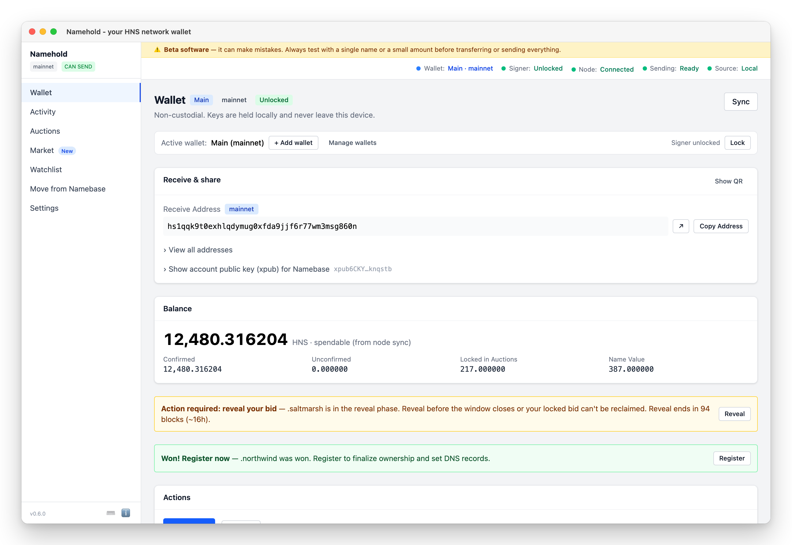
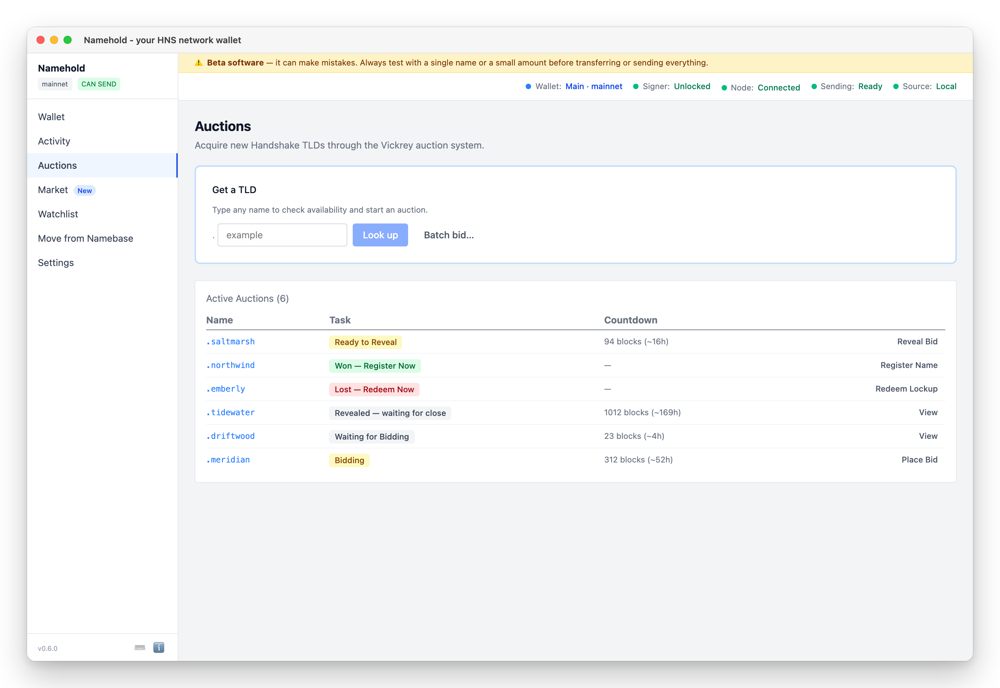
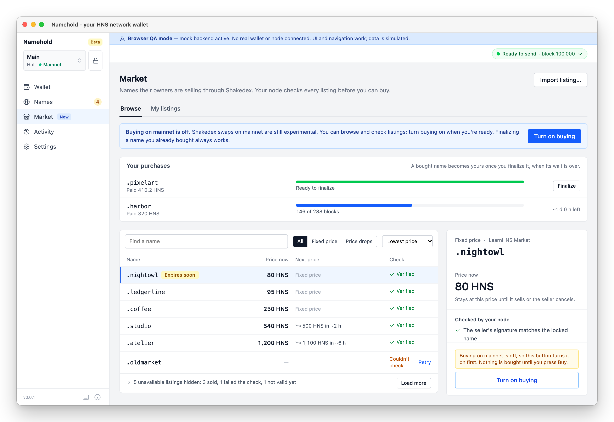
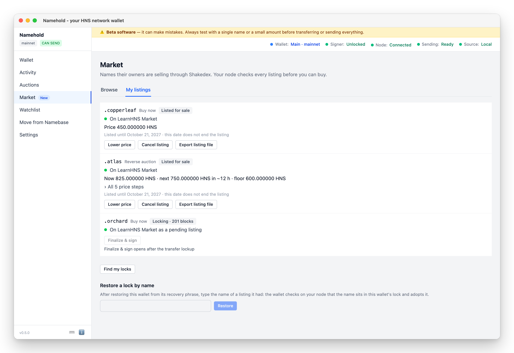
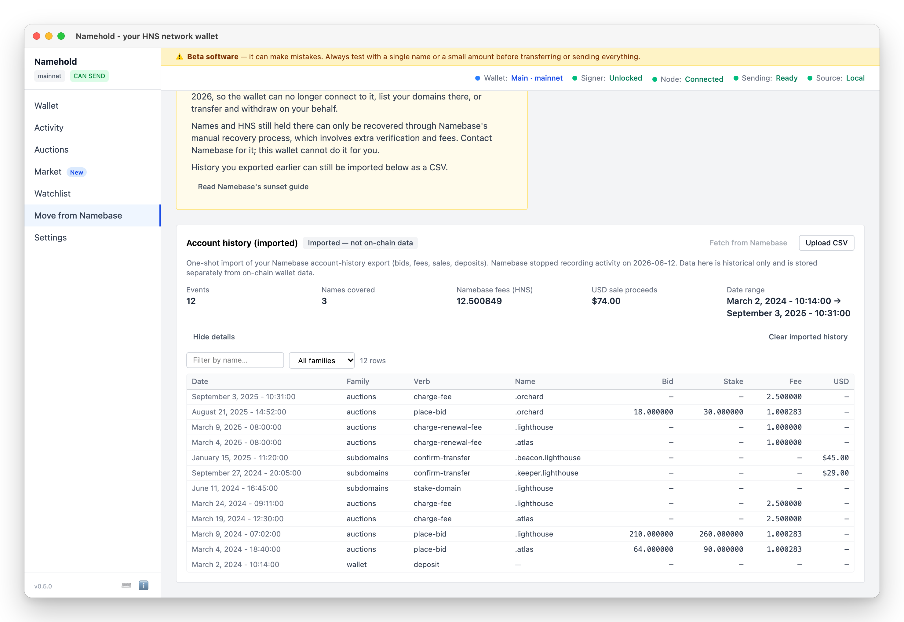

# Namehold — a non-custodial Handshake (HNS) wallet

[](https://github.com/DimazzzZ/namehold-wallet/pull/50)

Namehold is a local desktop wallet for **Handshake (HNS)**: hold HNS, manage the
names you own, run the full name-auction lifecycle, and edit on-chain DNS — all
non-custodially, with your keys encrypted on your own machine. It used to include a **Move from Namebase** helper; the legacy custodial Namebase closed on 1 October 2026, so that screen now explains the shutdown and keeps only the import of history you exported earlier.

Built with Tauri v2, React + TypeScript, Rust, and SQLite.

<p align="center">
  
</p>

> ⚠️ **Beta software.** Namehold is under active development and can make mistakes.
> Transactions, transfers and name sales are **irreversible** — always test with a
> single name or a small amount and confirm it arrives **before** sending or
> transferring everything.

## Screenshots

<table>
  <tr>
    <td width="50%"><a href="docs/assets/auctions.png"></a></td>
    <td width="50%"><a href="docs/assets/market.png"></a></td>
  </tr>
  <tr>
    <td align="center">Auctions</td>
    <td align="center">Market (Shakedex)</td>
  </tr>
  <tr>
    <td width="50%"><a href="docs/assets/market-listings.png"></a></td>
    <td width="50%"><a href="docs/assets/namebase-migration.png"></a></td>
  </tr>
  <tr>
    <td align="center">Selling your names</td>
    <td align="center">Namebase history</td>
  </tr>
</table>

The screenshots are generated from the app with showcase data: see [screenshots/README.md](screenshots/README.md).

## Install

Download the latest build from [Releases](https://github.com/DimazzzZ/namehold-wallet/releases/latest):

| Platform | File |
|----------|------|
| macOS (Apple Silicon and Intel) | `Namehold_<version>_universal.dmg` — not code-signed yet, see [macOS](#macos) |
| Windows | `Namehold_<version>_x64-setup.exe` |
| Linux | `Namehold_<version>_amd64.AppImage`, `.deb` or `.rpm` |

Once installed, the app updates itself (see [Auto-update](#auto-update-since-v020)). On first launch it asks how to connect: a local full node, a remote node or SPV.

## Features

### Wallet (the core)
- **Create or import** a wallet from a BIP39 mnemonic, or add a **watch-only**
  wallet from an account xpub.
- **Hardware wallet support** — connect a **Ledger Nano S / S Plus / X** and let
  the device sign every transaction. Private keys never leave the device; you
  confirm each send, bid, or covenant action on-screen. Requires the official
  [`ledger-app-hns`](https://github.com/handshake-org/ledger-app-hns) firmware.
- **Multiple wallets** — switch between them and delete ones you no longer need.
- **Receive** — your address with a QR code and one-click copy. Expand "View all
  addresses" to see the full list of derived receive addresses with derivation
  index, used/fresh badge, first-seen date, copy/QR/explorer buttons, and a
  "Generate new address" button to allocate the next unused index.
- **Per-wallet balances** — each wallet shows its own balance; values persist and
  refresh on demand (no bleed between wallets).

### Send HNS
- A **build → sign → broadcast** draft flow: preview fee/change before any key is
  touched, sign in the secure window, then broadcast.
- **Fee-rate control** — set a global default fee rate in Settings > Advanced, or
  override per-transaction with a collapsible "Advanced" widget in every send/bid/
  batch flow. Minimum 1000 doos/kvB (1 sat/byte).
- **Send Max** to sweep a wallet.
- **Status tracking** — sent transactions move Pending → Confirmed (with block
  height); a transaction the node did not accept reads "Not sent", and one that
  never makes it on-chain is flagged with the reason.
- **Speed up** — a sent, unconfirmed transaction or purchase that pays too little
  for full blocks gets a child transaction that pays for both (hsd has no
  replace-by-fee), from Activity or Your purchases.

### Names & auctions
- The complete Vickrey-auction lifecycle: **open, bid, reveal, redeem, register,
  update, transfer, finalize, cancel, renew, revoke**.
- **Phase badges + countdowns** for each owned name, a **reveal-required alert**,
  and a **"Locked in Auctions"** balance for in-flight bids.
- A typed **DNS-record editor** (TXT/A/AAAA/NS/CNAME…) for register/update, with a
  raw-JSON fallback.
- **Several bids on one name**, each with its own value and lockup; Reveal and
  Redeem take all of them in one transaction.
- **Batch operations** — bid, renew, reveal, redeem, finalize or transfer multiple
  names in a single transaction. Multi-select checkboxes on the Owned Names table with a
  batch action bar and a confirmation modal showing estimated fee + name list.
- **Name watchlist** — track names you don't own for monitoring. Watchlist page
  in the sidebar with add/remove, tags, CSV import/export, and "Add to
  Watchlist" buttons in name modals.
- **Buy names on the Market** — browse LearnHNS Market listings, verified against your own node, or import a listing file, pasted JSON or a market.learnhns.com link, and buy at the current step. One list with search, filters and sorting sits beside a panel that shows the selected listing's price, what your node checked, and the price, market fee and network fee before you buy; the purchase then shows in Your purchases and Owned Names until you finalize it. Needs a node and a recovery-phrase wallet; on mainnet, buying is behind "Allow buying and selling names on mainnet through Shakedex (experimental)" in Settings, which the Market offers to turn on.
- **Sell names through Shakedex** — Sell, in a name's actions, locks the name for sale as a Buy Now or a reverse auction; once the transfer lockup is over, Finalize & sign sets the price or the schedule and signs every price at once. Market › My listings follows each listing to Sold or back home, with Lower price, Cancel listing and Finalize home, and Export listing file, and warns before buyers stop seeing a listing whose name nears expiry. A wallet restored from its recovery phrase finds its locked names on its first sync (Find my locks, or Restore a lock by name, for the rest), and a listing managed from another device of the same phrase is recognised and can be taken over. The listing file is a Shakedex v2 listing that the shakedex CLI can buy; on mainnet it can also be published on LearnHNS Market, where the app and the background daemon keep it at its current price. Needs a node that can send and a recovery-phrase wallet; mainnet selling is behind the same experimental setting as buying.
- **Recover lost bids** — if you lose your local bid data (reinstall, seed-
  restore, import from another wallet), Namehold can brute-force the bid value
  from your seed and reveal it before the window closes. See
  [`docs/RECOVER_LOST_BIDS.md`](docs/RECOVER_LOST_BIDS.md).

### Node-free reads
- Reads are **node-free by default** via the HNSFans explorer — no node required
  just to view your wallet. Only mainnet has a built-in explorer; testnet and
  regtest read node-free only with an explorer URL you configure. When your local hsd is synced, the app automatically
  switches to **node-authoritative** reads (owned names, balances, bid history)
  for faster, more reliable data. A local node is needed **only to send or
  perform name actions**.
- When you click a transaction, name, or address link, it opens on **Shakeshift**
  (https://shakeshift.com) for viewing on-chain details.

### Move from Namebase (retired)
- The legacy custodial Namebase (sunset.namebase.io) shut down on 1 October 2026 and no longer answers, so the wallet can no longer connect to it, list, transfer or withdraw. The screen says so, points to Namebase's sunset guide for the manual recovery of anything left there, and still imports an account-history CSV you exported earlier.

### Auto-update (since v0.2.0)
- Namehold checks for updates automatically ~30 seconds after launch. When a
  new version is available, a banner appears at the top of the window offering
  a one-click install; you can also check manually in **Settings > Updates**.
  Update bundles are **Ed25519-signed** at release and verified against the
  embedded public key before install; unsigned or tampered bundles are rejected.

### Background sync

- Namehold can keep your wallet data fresh even when the app is closed. A
  lightweight background daemon (`namehold-syncd`) wakes every 60 seconds and
  syncs all wallet profiles (UTXOs, name states, transactions) from each
  profile's node into the shared SQLite database.
- Controlled by a Settings checkbox **"Sync in background"** (default ON).
- When enabled, hsd stays running after you close the app so the daemon can
  query it; the next app launch adopts the running node (no duplicate spawned).
- Crash recovery: if the daemon dies, the app respawns it on startup.
- The background daemon never signs or broadcasts; it publishes listings already signed to LearnHNS Market (on mainnet, for listings you chose to publish), and sends the Shakedex "Ready to finalize" reminders, so they arrive with the app closed.

### Connections: local node, remote node, SPV

- **Chain source** in Settings → Connections (and the first-run screen) picks how
  the wallet reaches the network: **Local full node** (the app runs hsd on this
  device; the default), **Remote node** (an hsd you run elsewhere), **SPV** or
  **Read-only**.
- **Remote node** — point at an existing hsd's RPC; **Test connection** checks that
  it is reachable, synced and on the wallet's network before you save. Sending
  through it is off until you tick **"Allow sending via remote node"**. Your keys
  never leave the device either way.
- **SPV** — a **lightweight alternative** to the full node: it downloads only
  block headers (~tens of MB vs ~15GB), enabling fast first launch and minimal disk
  usage. **Balance and name data come from the explorer** — sending is blocked in SPV
  mode (read-only). hsd then runs with `--spv` instead of `--index-address
  --index-tx`.
- **Explorer failover** — all explorer HTTP requests support automatic failover to a
  configurable fallback URL.
- **SPV indicator** in the StatusStrip — shows "Explorer (SPV)" when in SPV mode.

### Keyboard-first navigation

- **Command palette** (⌘K / Ctrl+K) — fuzzy-searchable list of navigation targets
  and view actions on the current page. Type to filter, ↑/↓ to move, Enter to run.
- **Cheatsheet** (Shift+?) — overlay documenting all bindings for the current page.
- **Sections** — `1` Wallet, `2` Activity, `3` Auctions, `4` Market, `5` Watchlist,
  `6` Move from Namebase, `7` Settings.
- **Per-page shortcuts** — common flows without the mouse:
  - **Wallet** (`/`): `s` send, `r` refresh, `u` unlock, `q` toggle QR, `/` filter
    names, `j`/`k` + Enter to walk owned names
  - **Auctions** (`/auctions`): `/` lookup, `b` batch bid
  - **Market** (`/market`): `/` search, `i` import a listing, `j`/`k` + Enter to
    walk the list and press the listing panel's button
  - **Activity** (`/activity`): `/` search
  - **Watchlist** (`/watchlist`): `a` add name, `e` export CSV

## How it works

- **Reads are node-free** on mainnet. Balances and names come from the explorer
  and are cached locally per wallet; other networks need an explorer URL of yours. Links to transactions, names, and addresses open on Shakeshift.
- **Sending needs a node.** Broadcasting and coin/owner discovery use an **hsd**
  node over RPC: a local one the app can start/stop for you, or a remote one with
  sending allowed (Settings → Connections).
- **Secrets stay in a secure window.** Your mnemonic/passphrase is only ever typed
  into — and your backup phrase only ever shown in — a small **Rust-owned window**;
  it never passes through the web UI. At rest it's an **encrypted vault**
  (Argon2id + AES-256-GCM) inside the local database.
- **Write-capability gating.** Spend/name actions are enabled only when the signer
  is unlocked **and** the node is reachable, synced, and address-indexed — with a
  precise reason shown when any condition isn't met.
- **Background sync daemon.** When "Sync in background" is enabled (Settings → Connections, default ON), a separate Rust binary syncs all profiles every 60s. A cross-process DB lock table (`sync_locks`) coordinates the app's manual Sync and the daemon via heartbeats (10s) and stale-lock takeover (30s); the app's Sync takes the lock from a daemon run. A run whose lock is taken over stops at its next check, within one heartbeat, and the LearnHNS Market jobs read the lock row before each listing, so they stop at once. The daemon writes its PID to `~/.namehold/syncd.pid` for lifecycle tracking.

## Security

For a detailed threat model, attack surfaces, and mitigations, see [SECURITY.md](./SECURITY.md).

- **Non-custodial** — your keys live on your device, encrypted; nothing is custodied.
- **Secrets never reach the web layer** — entry/display happen in the secure window,
  and signing happens in Rust.
- **Local-first** — keys and secrets stay on your device (encrypted at rest). By
  default, balance and name lookups query the public HNSFans explorer, which sees
  your wallet addresses and tracked names. Run your own hsd node (Settings) to keep
  all lookups fully local. No cloud, no telemetry.
- **Auto-lock** — the unlocked signer times out after a configurable idle period.
- **Namebase migration (retired)** — the legacy Namebase it talked to shut down on 1 October 2026. A session cookie stored before then stays encrypted at rest and is never exposed to the web layer; disconnecting clears it. See [SECURITY.md](./SECURITY.md) for the threat model.

## Prerequisites

- [Node.js](https://nodejs.org/) 22+
- [pnpm](https://pnpm.io/) 11+ (CI pins `11.17.0` via the `packageManager`
  field; run `corepack enable` to match it locally)
- [Rust](https://www.rust-lang.org/tools/install) (stable, edition 2021)
- [hsd](https://github.com/handshake-org/hsd) — **only needed for sending / name
  actions** (reads work without it). Run it with `--index-address`.

## Quick start

```bash
git clone https://github.com/DimazzzZ/namehold-wallet.git
cd namehold-wallet
pnpm install
pnpm tauri dev
```

## Running a node (only to send)

Reads need no node. To send HNS or perform name actions, run an **address-indexed**
hsd node:

```bash
hsd --index-address --index-tx --api-key=<your-key>
# mainnet node RPC: http://127.0.0.1:12037
```

- `--index-address` is **required** (the wallet finds your coins by address);
  `--index-tx` backs transaction history + confirmation tracking.
- The app can manage hsd for you — set the **data directory** and (if needed) the
  **hsd binary path** in **Settings → Connections**, then click **Start hsd**.
- **hsd can't add an index to an already-synced chain.** If your existing chain
  was synced without these indexes, the app detects it and offers a **one-click
  re-sync** (it moves the old chain to a backup and re-syncs with the right indexes).

| Network | Node RPC port |
|---------|---------------|
| Mainnet | 12037         |
| Testnet | 13037         |
| Regtest | 14037         |

See [`docs/NODE_SETUP.md`](docs/NODE_SETUP.md) and
[`docs/REGTEST_TESTING.md`](docs/REGTEST_TESTING.md) for details.

## Move from Namebase

The legacy custodial Namebase (sunset.namebase.io) closed on 1 October 2026 and answers every request with "Namebase has shut down", so this helper can no longer connect, list your custodial domains, transfer names out or withdraw HNS. Namebase's own guide says anything still held there now goes through a manual recovery process with extra verification and fees; the **Move from Namebase** screen links to it. What still works is importing an account-history CSV you exported from Namebase before the shutdown.

## Build for production

```bash
pnpm tauri build
```

Output in `src-tauri/target/release/bundle/` — macOS `.app`/`.dmg`, Windows `.msi`
and `-setup.exe` (releases ship the `-setup.exe`), Linux `.AppImage`/`.deb`/`.rpm`. CI (PR tests), a dependency-audit gate (`cargo audit` +
`pnpm audit`), and the cross-platform release pipeline live in
[`.github/workflows`](.github/workflows).

## macOS

The macOS build is not code-signed. On first launch macOS may show:

> "Namehold" can't be opened because Apple cannot check it for malicious software.

To remove the quarantine flag, run:

```bash
xattr -cr /Applications/Namehold.app
```

Then open the app normally.

## Data location

All app data lives in one SQLite file in your home folder (pairs with hsd's `~/.hsd`),
on every platform:

- `~/.namehold/portfolio.db`
- `~/.namehold/syncd.pid` — background sync daemon's process ID (present only
  while the daemon is running)

It holds your wallet profiles, the encrypted vault, the local chain cache, and (if
used) the local transaction history.

## Tech stack

- **Tauri v2** — desktop shell
- **React 19 + TypeScript** — frontend
- **Vite** — build tool
- **TanStack Query** — async state (TanStack Table + Virtual for data tables and
  virtualized lists)
- **Zustand** — client state
- **Zod** — validation
- **SQLite (rusqlite)** — local database
- **reqwest** — HTTP client (explorer + hsd RPC)
- **secp256k1 · bip39 · argon2 · aes-gcm · zeroize** — keys, mnemonics, vault crypto
- **hidapi** — Ledger hardware wallet HID transport
- **notify-rust** — cross-platform OS notifications (watchlist alerts)
- **Tailwind CSS** — styling

## Coverage

Unit test coverage is measured with `cargo-llvm-cov` on nightly:

```bash
just coverage
# or manually:
cargo +nightly llvm-cov --lib --ignore-filename-regex '(src/lib\.rs|src/daemon/mod\.rs)'
```

**Why nightly?** The codebase uses `#[cfg_attr(coverage_nightly, coverage(off))]`
attributes to exclude genuinely-untestable IO shells (device spawning, OS window
construction, USB-HID communication, HTTP requests) from coverage metrics, so that
coverage numbers reflect testable logic only. These attributes require the
`coverage_attribute` feature, which is nightly-only. The stable build is unaffected
— the attributes are no-ops when `cfg(coverage_nightly)` is not set.

**Why ignore `daemon/mod.rs`?** The daemon entry point (`run()`, `sync_all_profiles`,
`write_pid_file`, `cleanup`) is 100% IO shell — it cannot be unit-tested without a
live database and a running event loop. Excluding it from coverage metrics prevents
it from dragging down the overall number, while the pure logic it orchestrates
(in `daemon::*` submodules and `commands::*`) is independently tested and counted.

**Why is `run()` in `lib.rs` `coverage(off)`?** `tauri::generate_handler!` inside it expands one IPC wrapper per command, and llvm-cov counts each wrapper on its `#[tauri::command]` line in the command's own file, where it only runs through the real IPC dispatcher. Unit tests call the command function directly, so without the attribute every command showed one red line (134 of them) that no test can reach.

**What are the remaining ~1.6% uncovered lines?** After Phases 1–5, the residual
uncovered lines fall into structurally-untestable categories that are documented
in-place (via `coverage(off)` annotations) or intentionally left as-is:

- **Interactive webview orchestration** (e.g., wallet-secure-prompt flows in
  `commands/secure_wallet.rs`) — requires a live OS window and user input; no
  injectable seam exists at the current abstraction level.
- **Mutex-poison closures** (`.map_err(|e| AppError::Lock(e.to_string()))`) —
  only trigger if a thread panics while holding a lock; structurally
  unreachable in unit tests.
- **BIP32 mathematical impossibilities** — early-return branches guarded by
  child-derivation invariants that hold for all valid inputs.
- **Region-boundary artifacts** — closing braces of nested `.map()`/`if let`
  chains counted by `llvm-cov` as separate regions but not corresponding to any
  distinct code path.

The `truthfulness invariant` for this project's coverage number: an
`coverage(off)` annotation is only added when either (a) the function's
testable logic is confirmed 100% covered by direct tests, or (b) the missed
lines are structurally unreachable. No annotation hides genuinely-reachable
logic from measurement.

Coding conventions, layering rules and the pre-commit gates are in
[docs/CODING_STANDARDS.md](./docs/CODING_STANDARDS.md); feature specs live in
[docs/specs/](./docs/specs/).

## End-to-end tests

The IO-shell paths excluded from the unit-coverage number above (app lifecycle
in `lib.rs`, the background daemon in `daemon/mod.rs`, and interactive secure-window
flows) are exercised separately by an end-to-end suite that drives the built app
through WebDriver. See [`e2e/`](e2e/README.md).

```bash
cd e2e
pnpm install
pnpm test   # requires a release build + the Tauri WebDriver running on :4444
```

The E2E suite uses [WebdriverIO](https://webdriver.io/) with the Tauri WebDriver
(`tauri driver`, from `@tauri-apps/cli`). It runs in CI on Linux via
`.github/workflows/e2e.yml` after a `pnpm tauri build --debug --no-bundle`. These tests
deliberately cover the runtime-only surface that unit tests cannot reach, so the
two suites are complementary rather than overlapping.
